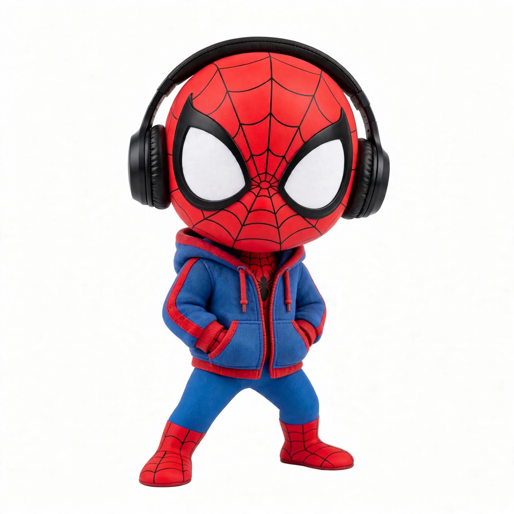

# Spidie 🕷️

A chibi Spider-Man avatar — oversized round head, black over-ear headphones, blue-and-red hoodie with hands in the pockets. Chill, cute, and ready to swing into your profile picture.



## What's inside

- `image.png` — the avatar (1600 × 1600 PNG)
- `LICENSE` — MIT

## Use it

Clone it and use the images directly — no build step, no dependencies:

```bash
git clone https://github.com/Active-Learning-Kyle/spidie-avatar.git
```

Then set any PNG as your profile picture — GitHub, Discord, X, you name it.

## Use with your own Muse

Want this look for your own Muse? The repo gives you the static images; two quick steps finish the job:

1. **Avatar**: send your Muse one of the PNGs and say "change your avatar to look like this". Muse will generate a matching avatar from it as reference. The animated versions (idle, working, etc.) are generated automatically by the system after the avatar is set — they can't be copied over from this repo.
2. **Name**: just tell your Muse "your name is Spidie". Names are per-user — each person names their own Muse.

## License

MIT — free to use, remix, and share. See [LICENSE](LICENSE).
